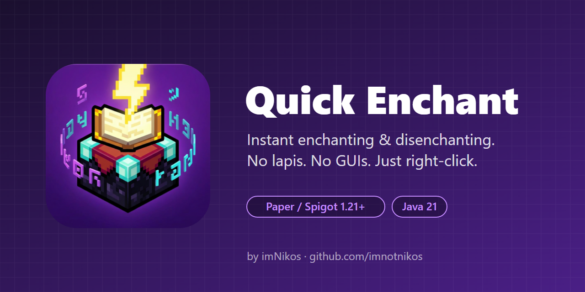

# Quick Enchant
Quick Enchant is a lightweight **Paper, Spigot, & Bukkit** plugin for 1.21+ that speeds up the enchanting and disenchanting process. It allows players to right-click an enchanting table to instantly enchant their held item, or right-click a grindstone to instantly wipe an item clean. No lapis is required, and it completely bypasses the vanilla GUIs.

***
### Plugin made by imNikos.
 

***

## Features
**Instant Enchanting**: Right-click an enchanting table with an enchantable item to instantly consume EXP and apply enchantments.

**Instant Disenchanting**: Right-click a grindstone with an enchanted item to instantly strip all enchantments off of it, skipping the menu entirely.

**Custom Item Pools**: Configure specific enchantments and levels for any item. Set specific enchantment(s) for an item, or make it randomly pick from a list of customized options.

**Table Profiles**: Link physical enchanting tables in your world to specific profiles. You can have a standard table at your spawn and an "Overpowered" table that applies completely different enchantments.

**In-Game Configuration**: Add new enchantment configurations directly from the game using commands. 

**Vanilla Exclusions**: If an item is not in your custom config, it pulls a random level-appropriate enchant from the vanilla pool. You can easily blacklist specific vanilla enchantments like Curse of Vanishing or Mending so they never roll.

## Commands

**Setup & Table Linking**

/qe link [profile] – Link the table you are looking at to a profile (e.g., default or vip).

/qe unlink – Makes the table you are looking at use the standard default settings again.

/qe reload – Refreshes the configuration file.

**Managing Enchantments**

/qe add [enchant] [level] to [item] [profile]

Example: /qe add sharpness 5 to diamond_sword

Grouped Example: /qe add [sharpness,unbreaking] [5,3] to diamond_sword (These will always roll together).

/qe remove [enchant] to [item] [profile] – Removes a specific enchantment from an item's possible pool. 

/qe exclude [enchant] to [item] [profile] – Blacklists a vanilla enchantment so it never appears on that item.

/qe reset [profile] – Clears all enchantments from a specific profile.

**Viewing Info**

/qe list profile [name] – See all enchants set up for a specific profile.

/qe list item [item] – See every profile that has special settings for that item.

_Available aliases:_ /qe, /quickenc

## Permissions
quickenchant.admin : Required to use any of the setup or reload commands. Regular players do not need any permissions to right-click and use the tables or grindstones.

## Requirements
A Minecraft server running **Paper, Spigot, or Bukkit 1.21 or newer**.

Java 21.

# Installation
## For Server Owners
Navigate to the Releases page.

Download the latest QuickEnchant.jar.

Place the file into your server's /plugins/ directory.

Restart your server or use a plugin loader to enable it.
